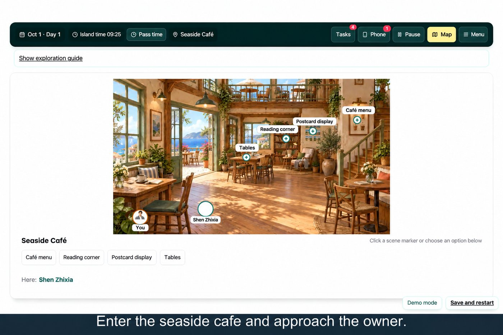
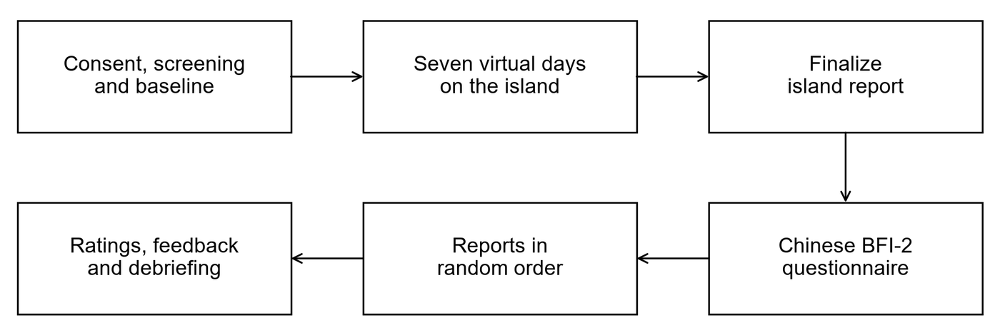
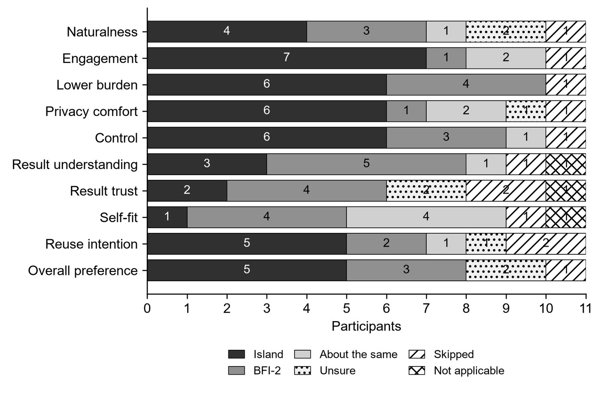
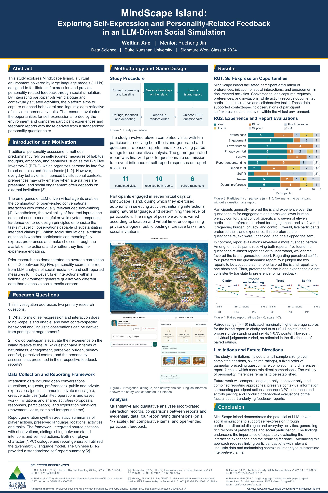

# MindScape Island (潮汐岛)

**A full-stack, LLM-driven social simulation for studying self-expression and personality-related feedback.**

Players spend **seven virtual days** on a browser-based island: they talk to LLM-powered residents in their own words, choose everyday activities, and create things. Every visit ends with a **source-cited observation letter** generated from the player's recorded words and actions, then compared against the validated Chinese **BFI-2** personality questionnaire in a formal user study.

*Signature Work · Weitian Xue · Data Science, Duke Kunshan University · Mentor: Prof. Yucheng Jin*

[**▶ Play the reviewer demo**](https://review.mychaoxidao.com/review) · [What it is](#what-it-is) · [System design](#system-design) · [Study & results](#study--results) · [Paper & poster](#paper--poster) · [Run it yourself](#run) · [Rights & sources](#rights-and-sources)


---

## At a glance

| | |
|---|---|
| **What it is** | A playable 2D social simulation + an IRB-approved user study (DKU IRB `2026SX211#`) |
| **World** | 8 island settings · 7 virtual days · 19 interaction points · 33 object operations · 15 shared-activity types |
| **Characters** | 11 LLM residents (8 permanent + 3 rotating visitors), each with biography, scene context, dialogue history and memory |
| **Stack** | Next.js / React frontend · Python FastAPI backend · SQLite persistence · Docker Compose deployment · Qwen Max 3.8 (`qwenmax3.8`) for dialogue and report generation |
| **Study** | 11 completed formal sessions · 10 participants received both reports · 6 complete paired rating sets |
| **Headline finding** | 7/11 participants preferred the island for **engagement**, but only 1/10 found its report a better **self-fit** than the questionnaire — a preferred experience is not automatically a preferred assessment |

## What it is

Traditional personality assessment relies on abstract self-report questionnaires such as the Big Five Inventory-2 (BFI-2). Game-based assessment makes decisions observable but usually restricts players to scripted choices. Inspired by *Generative Agents* (Park et al., 2023), MindScape Island asks a different question:

> If people are given everyday situations where they can decide **what to say and what to do**, what can we learn about them from the choices they make — and can a generated report of those choices stay faithful to the evidence?

A visitor explores the island freely: ordering at the café after asking the owner about the menu in their own words, arranging flowers in the workshop, posting invitations on the social feed, or joining shared activities with residents. The system records both **language** (questions, requests, preferences) and **completed actions** (orders, saved work, attendance), keeping stated intentions strictly separate from what actually happened. At the end of the visit, an evidence-grounded pipeline turns these records into a narrative letter about the visit — every observation linked to its source records.



The study compares this experience and its report with the Chinese BFI-2 along two research questions:

- **RQ1 — Expression & evidence:** What opportunities for self-expression does the island provide, and what context-specific observations can the recorded behavioral and linguistic data support?
- **RQ2 — Experience & feedback:** How do participants compare the island with the questionnaire in naturalness, engagement, burden, privacy comfort, control, and the feedback of the two reports?

## System design

```
Next.js / React client (browser)
        │  HTTPS
        ▼
FastAPI backend ── world services: virtual time, actions, NPC state
        │                │
        │                ├─ agents/   LLM dialogue, response checks
        │                └─ study/    study workflow, instruments, reports
        ▼
SQLite (research DB)          reviewer.sqlite (isolated reviewer DB)
```

**LLM residents with grounded context.** NPC prompts combine role biography, the current scene, recent dialogue and character memory. The backend — not the model — owns virtual time, available actions and completion records, so a resident cannot "promise" an action the world cannot execute, and a discussed plan is never logged as a completed event.

**Evidence-constrained report generation.** The island letter is produced in four steps:

1. **Evidence packets** — game records are grouped by situation; every record keeps a reference to its original source.
2. **LLM draft** — the model writes observations required to cite records, distinguish intentions from completed actions, and stay within what happened on the island. Fabricated quotations, diagnostic claims and fixed trait attributions are prohibited.
3. **Audit & repair** — quotation accuracy, speaker attribution and evidence support are checked; claims that exceed the evidence are flagged for revision.
4. **Freeze** — the report is versioned and frozen *before* the participant completes the BFI-2, so questionnaire answers cannot influence it.

A **controlled fallback report** assembled from verified facts guarantees a deliverable even when generation fails. The formal reports carry no numerical personality scores: the letter is a narrative of situated observations, not a test result.

> **Study version vs. repository.** Participants evaluated the static v3 reports. This repository additionally contains a later implementation that structures behavior and language into contextual episodes with offline re-evaluation outputs; participant analyses remain bound to the reports participants actually read.

## Study & results

**Procedure** (within-subject, descriptive): consent & screening → seven virtual days → island report generated and frozen → Chinese BFI-2 → reports shown in random order → ratings & feedback.



11 sessions completed; one participant left a BFI-2 item unanswered, so 10 received both reports and 6 provided complete paired ratings.

**Experience preferences** (counts out of 11; report items out of 10):



**Paired report ratings** (1–7 scale, n = 6): the island letter scored slightly higher on all four dimensions — clarity and trust +0.17, process understanding and self-fit +0.33 — while individual judgments varied and direct self-fit preference mostly favored the questionnaire or tied (1 island / 4 BFI-2 / 4 same / 1 skipped).

**Evidence coverage.** The number of retained quoted entries correlates strongly with report length (Spearman ρ = 0.867, n = 11), exposing a practical issue: reports lean on language, and less vocal participants risk being under-represented even when their actions are well recorded. Case analyses show both well-supported observations (a breakfast preference traced across three dialogue turns; a completed flower arrangement plus an organized shop visit) and over-interpretations where a citation exists but does not support the inferred motive.

**Takeaway.** The island succeeds as an environment for situated self-expression — engagement, control and overall preference lean toward it — but the precision of its personality-related interpretations remains unvalidated. Future work: language-only vs. behavior-only vs. combined reports under a consistent format, independent evaluation of factual support, and better NPC coherence and activity pacing.

> All results are exploratory and describe this cohort only (small sample, fixed task order, differing report formats). No claim of personality-measurement validity is made.

## Paper & poster

Both documents are included in this repository:

- [**Paper (PDF)**](docs/paper.pdf) — the full write-up: research questions, system design, study procedure, results, and limitations.
- [**Poster (PDF)**](docs/poster.pdf) — a one-page visual summary of the project.

Click the preview to open the full-resolution poster:

[](docs/poster.pdf)

## Try the reviewer demo

Visit the [reviewer demo](https://review.mychaoxidao.com/review) and enter the shared access code `MindScape-GFWWTXZUGUF5`. Choose a nickname, accept the experience notice, and start playing. The code can be reused, and each browser keeps separate saves. You can resume a previous visit or start a new one without deleting earlier progress or reports. Save your personal recovery code to restore your records on another device or after clearing browser data. Reviewer records are stored separately and excluded from the research dataset.

> **Availability & data retention.** In accordance with the IRB application (DKU IRB `2026SX211#`), the hosted reviewer demo will cease maintenance and become inaccessible after **December 2026**. All personal data collected through the demo will be transferred to the Duke Kunshan University research database and destroyed within the retention period specified in the approved protocol. The repository remains available for self-hosting under the terms below.

## Repository structure

```
backend/
  agents/      Dialogue, model transport, and response checks
  assets/      Island artwork
  content/     World packs and activity content
  data/        Static world data
  services/    Simulation, activities, and persistence
  study/       Study workflow, instruments, and reports
  world/       World definitions and rules
  main.py      FastAPI application
frontend/
  app/         Next.js routes and study pages
  components/  Game and study interfaces
  hooks/       Shared React hooks
  lib/         Client and server utilities
  public/      Static resources
deploy/        Container recipes and example configuration
scripts/       File integrity check
docs/          Paper and poster (PDF)
  images/      README figures and poster preview
```

## Source version

The core game corresponds to the formal-study deployment of 26 October 2026: world `chaoxi-holiday-v6`, experience `island-life-20261026-v1`. This repository also includes the independent reviewer entry deployed on 2 November 2026. Contact details have been replaced with placeholders and comments shortened; gameplay, prompts, scoring, and artwork retain the deployed implementation.

The assessment integrity check includes source comments. This copy therefore uses a new fingerprint, recorded alongside the production fingerprint in `RELEASE.json`. Existing production reports remain bound to their original version.

## Run

The container recipes use Python 3.13, Node.js 22, and locked dependencies. From the repository root:

```bash
cp deploy/server.env.example deploy/server.env
```

Set `STUDY_PUBLIC_ORIGIN`, `LLM_API_KEY`, and `STUDY_CONTACT_ENCRYPTION_KEY` in `deploy/server.env`. The contact key must be a Fernet key; generate it in a Python environment with `cryptography` installed:

```bash
python -c "from cryptography.fernet import Fernet; print(Fernet.generate_key().decode())"
```

Then start the stack:

```bash
docker compose --env-file deploy/server.env -f deploy/compose.yaml config --quiet
docker compose --env-file deploy/server.env -f deploy/compose.yaml up -d --build
```

The gateway listens on `127.0.0.1:8080`. Configure an HTTPS reverse proxy at `STUDY_PUBLIC_ORIGIN` and open `/study/start`. The model configuration preserves the study's Qwen endpoint and model name; it requires a compatible service account. Use a fresh database and encryption key for a separate installation.

Invitations are managed by `python -m study.admin --help` from `backend/`, with an explicit `DATABASE_URL`. No formal-study invitation codes, private credentials, participant records, or databases are included. Consent contacts are placeholders and must be replaced before any new study.

## Verify

```bash
python scripts/verify_release.py --strict
```

Run this before building: Next.js can regenerate `next-env.d.ts`. `.gitattributes` preserves line endings used in source hashing. Backend content and assessment checks, after installing `backend/requirements.lock`, run from `backend/`:

```bash
python -m content.validator --pack content/packs/chaoxi_holiday_v6
python -m study.production_letter
```

The development test suite is not included in this deployment snapshot; the retained `test:e2e` npm entries require that suite.

## Reviewer entry (self-hosting)

The optional reviewer entry at `/review` uses a reusable admission passphrase and separate browser accounts. Each account can retain several visits, resume progress, or recover its history with a personal recovery code. Reviewer data must use its own `reviewer.sqlite` database and volumes; never mount the research database into this service.

Set `REVIEW_MODE=true` in both services. The backend also requires `REVIEW_ACCESS_CODE_SHA256` (the SHA-256 digest of the admission passphrase) and a random `REVIEW_SIGNING_SECRET` of at least 32 characters. Keep that signing secret stable so existing recovery codes continue to work. The isolated deployment is defined in `deploy/compose.review.yaml`; its review Dockerfiles extend the tagged formal-release images and preserve the gameplay assets. Credentials belong in an untracked `deploy/review.env`.

## Rights and sources

No project-wide open-source license is granted. Third-party terms remain applicable; notices for adapted dialogue materials are in [NOTICE](NOTICE).

BFI-2 is copyrighted by Christopher J. Soto and Oliver P. John and is available for noncommercial research under its [official terms](https://www.ocf.berkeley.edu/~johnlab/bfi.html). Chinese wording follows Zhang et al. (2022), *The Big Five Inventory-2 in China*, *Assessment*, 29(6), 1262–1284. Questionnaire materials remain subject to their authors' terms; this repository grants no additional rights to them. Reading excerpts retain source attributions in the content modules.

## Key references

- Soto, C. J., & John, O. P. (2017). The next Big Five Inventory (BFI-2). *Journal of Personality and Social Psychology.*
- Zhang, B., et al. (2022). The Big Five Inventory-2 in China. *Assessment*, 29(6), 1262–1284.
- Park, J. S., et al. (2023). Generative Agents: Interactive Simulacra of Human Behavior. *UIST.*
- Barends, A. J., de Vries, R. E., & van Vugt, M. (2022). Construct and predictive validity of an assessment game to measure Honesty–Humility. *Assessment.*
- Mislevy, R. J., Almond, R. G., & Lukas, J. F. (2003). A brief introduction to evidence-centered design. *ETS Research Report Series.*

## Acknowledgments

Thanks to my mentor Prof. Yucheng Jin, the study participants for their time and candid feedback, and Jerry Zheng for game-design ideas and inspiration.
